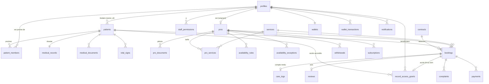

# MyNurse : architecture backend (Supabase)

Version du 24/11/2026. Elle couvre les migrations `0008` à `0013` et les étapes en attente `0014` et `0015`.

## 1. Point de départ

La base de production (projet `brqzagwexxesowihehjt`) compte 15 tables, toutes protégées par RLS (Row Level Security, règles d'accès par ligne), et 47 fonctions. **Elle est vide** : aucun compte, aucune réservation.

Les migrations du dépôt, rejouées sur un PostgreSQL local, produisent exactement les mêmes 47 fonctions que la production (empreintes identiques).

| Constat | Correction |
|---|---|
| La migration `commission_10` existe en production mais pas dans le dépôt | `0008_commission_10.sql` (idempotente) |
| Le rôle `admin` donne accès à tout, y compris aux comptes rendus de soin (données de santé) | Permissions précises par administrateur (0009) |
| Les données médicales sont des colonnes de `patients`, lisibles par tout soignant ayant eu un rendez-vous, sans limite de durée | Dossier séparé, accès temporaires et révocables (0009, 0010) |
| Aucun accès possible pour un proche ou un aidant | `patient_members` (0009) |
| Aucune trace de qui consulte un dossier | Journal d'audit en ajout seul, lecture du dossier tracée (0009, 0010) |
| Prix du soignant non contrôlé côté serveur | Contrôle de la fourchette du catalogue (0011) |
| Toutes les fonctions du schéma `private` sont exécutables par tout le monde (droit par défaut de PostgreSQL) | Droit retiré ; seules les fonctions utilisées par les règles d'accès restent ouvertes (0009) |
| Pas de disponibilités, réclamations, pharmacies, historique d'abonnement, ni de suivi des paiements échoués | Nouvelles tables (0011) |
| Retraits sans traitement du résultat (réussi ou échoué) | `admin_settle_withdrawal`, avec recrédit automatique (0011) |

## 2. Schéma cible

Légende : **=** inchangé · **~** modifié (ajouts seulement) · **+** nouveau.

| Domaine | Tables |
|---|---|
| Comptes et rôles | **=** `profiles` · **+** `staff_permissions` |
| Patients et proches | **~** `patients` · **+** `patient_members` |
| Soignants et vérification | **~** `pros` · **=** `pro_documents` · **=** `pro_cancellations` |
| Catalogue et prix | **=** `services` · **~** `pro_services` (contrôle du prix) |
| Disponibilités | **+** `availability_rules` · **+** `availability_exceptions` |
| Rendez-vous et suivis | **~** `bookings` · **~** `contracts` |
| Dossier médical | **+** `medical_records` · **+** `medical_documents` · **+** `vital_signs` · **~** `care_logs` · **+** `record_access_grants` |
| Argent | **=** `wallets` · **=** `wallet_transactions` · **+** `payments` · **~** `withdrawals` · **+** `subscriptions` |
| Qualité | **~** `reviews` (modération) · **+** `complaints` |
| Services publics | **+** `pharmacies` |
| Plateforme | **+** `platform_settings` · **~** `notifications` · **+** `audit.events` |

**Ce qui n'est pas dupliqué :**

- **Commissions.** La commission reste figée sur chaque réservation (`bookings.commission`, `commission_rate`). Son taux vient de `platform_settings`. Le rapport financier se calcule à la demande (`admin_commission_report`), sans table en double.
- **Paiements.** `payments` enregistre l'argent réel reçu de l'agrégateur Mobile Money, y compris les paiements en attente ou échoués. `wallet_transactions` reste le grand livre interne. Les deux n'enregistrent pas la même chose.
- **Abonnements.** `pros.premium_until` reste la valeur lue par la recherche. `subscriptions` en garde l'historique.

### Relations



**Règles de suppression :**

- Supprimer un compte supprime ses patients. Supprimer un patient supprime son dossier, ses documents, ses constantes et ses accès.
- L'auteur d'un document ou d'une mesure est protégé (`on delete restrict`) : on ne peut pas effacer la traçabilité d'un acte médical.
- `audit.events` n'a volontairement aucune clé étrangère : le journal survit à la suppression d'un compte.

### Index ajoutés

- Chaque nouvelle clé étrangère a son index.
- Sur les tables existantes : `bookings(service_id)` et `bookings(status, scheduled_at)` (tâche d'expiration lancée chaque minute), `pro_cancellations(booking_id)`, `wallet_transactions(booking_id)`, `pros(referred_by)`, `contracts(booked_by)`.
- Index partiels pour les files de travail : réclamations ouvertes, retraits et paiements en attente, notifications non lues.

## 3. Rôles et matrice d'accès

**Rôles applicatifs** (`profiles.role`) : `patient`, `pro`, `admin`. Le rôle `admin` ne suffit plus. Chaque action d'administration exige une permission (`staff_permissions`) :

| Permission | Donne accès à |
|---|---|
| `verify_pros` | Dossiers et pièces des soignants ; valider, refuser, suspendre |
| `manage_bookings` | Rendez-vous, suivis, alertes de fiabilité |
| `finance` | Portefeuilles, paiements, retraits, abonnements, rapport des commissions, remboursements |
| `support` | Comptes, réclamations |
| `moderate` | Masquer un avis |
| `audit_read` | Journal d'audit (sa consultation est elle-même tracée) |
| `manage_settings` | Paramètres, pharmacies |
| `manage_staff` | Attribuer les permissions |
| `medical_break_glass` | Accès d'urgence à un dossier : 4 h, motif obligatoire, patient notifié. Attribuée par un **autre** administrateur, jamais par soi-même ni par l'amorçage |

**Qui lit quoi** (L = lecture directe, T = via `get_patient_chart`, lecture tracée ; écritures toujours via RLS ou fonction contrôlée) :

| Donnée | Titulaire | Proche | Soignant | Admin |
|---|---|---|---|---|
| Fiche patient (identité) | L | L | L (s'il a un rendez-vous) | — |
| Dossier médical | L, modifie | L si `view_records`, modifie si `manage_records` | **T**, selon l'accès en cours | **T**, accès d'urgence seulement |
| Documents médicaux | L | L si `view_records` | T (liste) + fichier si accès `documents` | idem |
| Constantes | L | L si `view_records` | T ; saisie si accès `vitals` | idem |
| Comptes rendus de soin | L | L si `view_records` ou `view_reports` | les siens ; ceux des autres si accès `reports` | **aucun** (accès d'urgence seulement) |
| Rendez-vous | les siens | si `book_care` ou `view_reports` | les siens | `manage_bookings`, `support`, `finance` |
| Portefeuille, paiements | le sien | — | le sien | `finance` |
| Réclamations | les siennes | — | les siennes | `support` |
| Journal d'audit | qui a lu ses dossiers (`my_record_access_log`) | — | — | `audit_read` |

## 4. Accès temporaires au dossier médical

Les accès sont stockés dans `record_access_grants`. Chaque accès a un bénéficiaire, un périmètre (`summary`, `vitals`, `documents`, `reports`, `full`), une date de fin, et peut être révoqué.

```
Demande de soin  → accès « summary » (identité, allergies, traitements) pour décider
Soin accepté     → élargi à summary + vitals + documents + reports
Refus, annulation → révoqué immédiatement
Fin du soin      → expire 24 h après la fin prévue (temps du compte rendu)
```

- **Le patient décide.** Il voit chaque accès, le révoque à tout moment (`revoke_record_access`), accorde un accès choisi à un soignant vérifié, par exemple son médecin traitant (`grant_record_access`, 365 jours au plus), et consulte qui a lu son dossier (`my_record_access_log`).
- **Les proches.** Le titulaire les ajoute par e-mail ou téléphone, avec des droits précis et une date de fin optionnelle (`add_patient_member`). Le message d'erreur ne révèle pas si un compte existe. Le titulaire retire un proche à tout moment, et un proche peut se retirer lui-même.
- **Côté app :** le titulaire voit le nom, le lien (« Fils ») et un contact masqué de chaque proche (`patient_members.display_name`, `relation_label`, `contact_hint`) ; un proche retrouve les dossiers qu'on lui a confiés avec le nom du titulaire et ses droits (`my_shared_patients()`).
- **Notifications à la famille.** Chaque notification de soin envoyée à la personne qui a réservé est aussi envoyée au titulaire du dossier et aux proches autorisés à suivre ou réserver (`private.notify`, redéfinie en 0009).
- **Les soignants** ne lisent jamais le dossier directement : uniquement via `get_patient_chart`, qui ne renvoie que le périmètre autorisé et écrit une ligne de journal à chaque appel.
- **L'urgence.** `admin_break_glass` donne 4 h maximum, avec un motif de 10 caractères au moins. Le patient et les administrateurs sont notifiés, et l'accès est journalisé.

## 5. Journal d'audit

`audit.events` vit dans un schéma non exposé par l'API. Il est en **ajout seul** : un déclencheur refuse toute modification, suppression ou vidage, y compris par le serveur.

| Événement | Ce qui est gardé |
|---|---|
| Modification d'une donnée de santé (`patients`, `medical_records`, `medical_documents`, `vital_signs`, `care_logs`) | Auteur, date, patient, **noms** des champs modifiés. Jamais les valeurs (le journal ne devient pas une copie du dossier) |
| Lecture d'un dossier par un tiers | Auteur, date, patient, périmètre lu |
| Accès accordé ou révoqué, proche ajouté ou retiré, accès d'urgence | État complet |
| Permissions de l'équipe, changement de rôle | État complet |
| Vérification des soignants, pièces, tarifs | État complet |
| Paiements, retraits, abonnements, réclamations, paramètres, modération | État complet |

## 6. Sécurité

**Ce qui est en place :**

- RLS active sur toutes les tables. Les nouvelles tables commencent par `revoke all` (Supabase accorde tout par défaut), puis reçoivent uniquement les droits utiles, colonne par colonne pour les écritures.
- Les écritures sensibles passent par des fonctions `security definer` à `search_path` vide, qui vérifient l'utilisateur appelant. Le linter Supabase signale ces fonctions (11 avertissements) : c'est voulu, chacune contrôle `auth.uid()` ou une permission.
- Les fonctions internes (`private.wallet_move`…) ne sont plus exécutables par les utilisateurs.
- Documents médicaux dans un bucket privé `medical-documents`, rangés par patient (`<patient_id>/…`), 10 Mo maximum, PDF, JPEG ou PNG. Un document n'est jamais supprimé depuis l'app : il est masqué (`deleted_at`).
- Les constantes ne se modifient pas. Une erreur est marquée par son auteur et ressaisie. Les valeurs improbables sont refusées.
- Un administrateur ne peut pas s'attribuer l'accès d'urgence : il faut deux personnes.

**Risques restants à traiter :**

1. **Hébergement.** Les données de santé sont à Francfort. Avant l'ouverture, vérifier le régime ARTCI : déclaration du traitement et transfert hors de Côte d'Ivoire.
2. **Lecture des fichiers.** Les URL signées sont créées par l'app : le fichier lui-même n'est pas journalisé, seulement la liste via `get_patient_chart`. Prochaine étape : une fonction Edge qui signe l'URL et journalise.
3. **Lectures des proches.** Elles sont directes, donc non journalisées. Le patient les a autorisées explicitement.
4. **Colonnes médicales de `patients`.** Pendant la transition (étape A), elles restent lisibles par un soignant ayant eu un rendez-vous, comme aujourd'hui. L’étape B (`0014`) les ferme.
5. **Clé service.** Elle contourne toute la RLS. Elle ne doit vivre que dans les fonctions Edge et le webhook de paiement, jamais dans l'app.
6. **Offre gratuite de Supabase.** Pas de sauvegarde à un instant précis (PITR). Pour des données de santé, passer à l'offre Pro avant l'ouverture.

## 7. Migrations et retour arrière

| Fichier | Contenu | Données existantes |
|---|---|---|
| `0008_commission_10.sql` | Déjà en production ; ajoutée au dépôt | — |
| `0009_access_control.sql` | Permissions de l'équipe, proches, accès temporaires, journal, durcissement des règles | Admins actuels : toutes les permissions sauf l'urgence. Accès créés pour les rendez-vous en cours |
| `0010_clinical.sql` | Dossier, documents, constantes, lecture tracée | Dossier recopié depuis `patients`, recopie automatique ensuite. `care_logs.patient_id` rempli |
| `0011_operations.sql` | Paramètres, prix, disponibilités, paiements, retraits, abonnements, avis, pharmacies, réclamations, index | Abonnements en cours repris dans `subscriptions`. Suivis enrichis depuis leurs séances |

Toutes ces migrations sont **additives** : aucune table, colonne ni donnée existante n'est supprimée. Les règles d'accès remplacées le sont dans la même transaction.

### Étapes

1. **A, maintenant.** Appliquer 0009 → 0011. L'app actuelle continue de fonctionner sans changement. Elle n'est pas modifiée par ces migrations : les écrans qui utilisent les nouvelles tables restent à faire.
2. **B, après la sortie de l'app** qui lit `medical_records` et `get_patient_chart` : déplacer `supabase/pending/0014_…` dans `migrations/`. Les colonnes médicales de `patients` ne sont plus exposées.
3. **C, 30 jours plus tard, sauvegarde faite** : `0015_…`. **Destructif**, protégé par une confirmation explicite.

### Avant d'appliquer

1. Lancer le test local : `PGHOST=… PGPORT=… supabase/tests/run_local.sh`. Il rejoue toutes les migrations sur un PostgreSQL local qui imite Supabase, puis 93 contrôles d'accès.
2. Faire une sauvegarde (Dashboard → Database → Backups, ou `pg_dump`).
3. Appliquer, puis lancer les advisors de sécurité et de performance.
4. Amorcer le premier administrateur, depuis l'éditeur SQL :

   ```sql
   select public.bootstrap_staff('<uuid>',
     '{verify_pros,manage_bookings,finance,support,moderate,audit_read,manage_settings,manage_staff}');
   ```

### Retour arrière

Les scripts `supabase/rollback/0011_down.sql`, `0010_down.sql` et `0009_down.sql` s'exécutent dans cet ordre, dans une transaction, et seulement après `set mynurse.confirm_rollback = 'yes'`.

- Ils remettent les fonctions et les règles d'accès dans leur version précédente, exacte puisqu'extraite de la base.
- Le dossier médical est recopié dans `patients` avant suppression.
- Les fichiers stockés ne sont jamais supprimés.
- Le journal d'audit est conservé.
- Les données des nouvelles tables sont perdues : chaque script liste ce qu'il faut exporter avant.

**Testé en local :**

- application des trois migrations, puis scénario complet de données ;
- retour arrière, qui donne un schéma identique à celui de la production actuelle (seuls les droits d'exécution durcis sont conservés volontairement) ;
- réapplication sans erreur, avec le journal conservé.

## 8. Impact sur l'app Flutter

- **Rien ne casse à l'étape A.** Mêmes tables, mêmes fonctions, même comportement pour patients et soignants. Les admins existants gardent leurs droits.
- **Prochains écrans** (refonte) :
  - Famille : `add_patient_member`.
  - Carnet de santé : `medical_records`, `medical_documents`, `vital_signs`.
  - « Qui a vu mon dossier » : `my_record_access_log` et `revoke_record_access`.
  - Fiche patient côté soignant : `get_patient_chart`.
  - Disponibilités du soignant.
  - Réclamations : `open_complaint`.
  - Admin : file des réclamations, retraits, rapport des commissions, modération des avis.
- Le webhook de paiement (fonction Edge, clé service) écrit dans `payments` avant d'appeler `confirm_topup` ou `confirm_payment`.

## 9. Espace soignant (0012)

| Sujet | Ce que fait la base |
|---|---|
| Statuts de vérification | `pending`, `incomplete`, `under_review`, `verified`, `expired`, `suspended`, `rejected`. `submit_pro_dossier()` fait suivre le statut aux pièces ; `admin_start_review` puis `admin_verify_pro` (permission `verify_pros`) |
| Validité des pièces | `pro_documents.expires_on`. `private.pro_docs_ok` exige chaque pièce obligatoire en cours de validité ; tâche quotidienne `expire_pro_documents` (statut « expiré » + notification) |
| Pas de demande sans vérification | `private.pro_is_active` vérifié à la réservation (`bookings_price_zz0_active`), à l'acceptation (`bookings_accept_active`) et dans `search_pros` |
| Champ d'exercice | Actes : `check_pro_service` (profession) + fourchette de prix. Constantes : `private.vital_in_scope` (déclencheur `vital_signs_scope`). Dossier : `get_patient_chart` limite l'aide-soignant(e) à l'essentiel (pas de documents, constantes ni antécédents) |
| Refus motivé | `refuse_booking(p_booking, p_reason)`, motif dans `bookings.refusal_reason`, transmis au patient |
| Journal de visite | `care_journal_entries` via `add_care_journal` (« en route » au plus 3 h avant, « arrivé » à partir de 30 min avant) ; la famille est prévenue |
| Incidents | `incident_reports` via `report_incident` (soignants seulement) ; les incidents graves alertent l'équipe en urgence ; lecture : l'auteur et la permission `support` |

Test local : 83 contrôles (`supabase/tests/run_local.sh`). Retour arrière : `rollback/0012_down.sql` (avant `0011_down.sql`) ; seules les trois valeurs ajoutées à l'enum restent (PostgreSQL ne sait pas les retirer), les dossiers concernés repassent « en attente ».

## 10. Console d'administration (0013)

| Fonction | Permission | Ce qu'elle fait |
|---|---|---|
| `admin_dashboard_context()` | tout membre de l'équipe | Ses permissions et des comptages agrégés (aucun nom, aucune donnée de santé) |
| `admin_cancel_booking(id, motif)` | `manage_bookings` | Annule (tout le suivi s'il y en a un), rembourse intégralement, prévient famille et soignant |
| `admin_refund_booking(id, montant, motif)` | `finance` | Rembourse sur le solde de la famille, plafonné à ce qui reste payé ; `bookings.admin_refunded` |
| `admin_extend_premium(pro, jours, motif)` | `finance` | Offre du Premium, inscrit dans `subscriptions` |
| `admin_broadcast(public, titre, message)` | `manage_settings` | Message collectif (patients, soignants actifs, ou tous) |
| `admin_update_incident(id, statut, note)` | `support` | Prise en charge et clôture, le soignant est prévenu |

Toutes écrivent dans `audit.events`. Déjà disponibles : `admin_update_complaint`, `admin_settle_withdrawal`, `admin_commission_report`, `admin_hide_review`, `admin_update_setting`, `admin_set_staff_permission`, `admin_audit_events`, `admin_break_glass`.

**Dossiers médicaux :** l'équipe ne lit ni `patients` ni `medical_records`. Le seul chemin est `admin_break_glass` : permission dédiée, attribuée par un autre responsable, motif d'au moins 10 caractères, 4 h, journalisé, famille prévenue.

Test local : 93 contrôles. Retour arrière : `rollback/0013_down.sql`, testé (schéma identique à l'état 0012).
